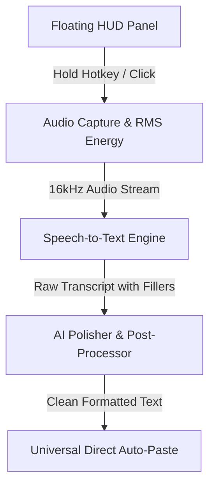

# 🎙️ Flow Widget — AI Voice Dictation Capsule for macOS

A native macOS floating capsule widget inspired by the reverse-engineered architecture of **Wispr Flow** and modern AI dictation assistants.

---

## 🏗️ The Reverse-Engineered Architecture

Modern voice-to-text dictation apps (like Wispr Flow, Superwhisper, and Oasis) operate across **5 distinct architectural layers**:



### 1. The Non-Activating Floating Panel
* **Challenge:** Normal macOS windows steal focus from whatever application the user is currently typing in (Slack, Chrome, VS Code, Notes).
* **Solution:** Uses an `NSPanel` with the `.nonactivatingPanel` style mask and `.floating` window level. The user can interact with the widget or look at it without their typing cursor ever leaving their active text editor.

### 2. Audio Capture & Waveform Visualizer
* **Pipeline:** Utilizes `AVAudioEngine` tapping into the default microphone input bus (`inputNode`).
* **Energy Calculation:** Computes the Root Mean Square (RMS) energy in real-time from the raw audio buffer:
  $$\text{RMS} = \sqrt{\frac{1}{N} \sum_{i=1}^N x[i]^2}$$
* This normalizes into dynamic heights driving the 7-bar audio waveform animation.

### 3. Speech Recognition (ASR)
* Built-in support for **Apple's native `SFSpeechRecognizer`**:
  * 100% free, runs offline on Apple Silicon / macOS.
  * Zero latency, no external API keys required.
* Optional hook for cloud Whisper (OpenAI / Groq) for high-entropy multi-language dictation.

### 4. The Core Secret: The AI "Polisher" Prompt
Raw speech recognition is filled with hesitations, stutters, false starts, and repeated words:
* *Raw input:* `"hey um can we meet uh tomorrow at like 2 wait no 3 pm thanks"`
* *Polished output:* `"Hey, can we meet tomorrow at 3:00 PM? Thanks."`

The engine applies a dual-mode approach:
1. **Zero-Latency Local Engine:** High-performance regex pipeline that strips fillers (`um`, `uh`, `like`), resolves self-corrections (`X wait no Y` $\rightarrow$ `Y`), formats numbers/times/currencies, and handles capitalization and punctuation.
2. **Cloud LLM Engine:** Integrates with any OpenAI-compatible endpoint (Groq, OpenAI, Ollama) using an optimized dictation prompt.

### 5. Universal Direct Injection (Auto-Paste)
* Once the text is polished, it writes the string into `NSPasteboard.general`.
* It then synthesizes an OS-level keyboard event:
  $$\text{Cmd} + \text{V}$$
  via `CGEvent(keyboardEventSource: nil, virtualKey: 0x09, keyDown: true)` posted directly to `kCGHIDEventTap`.
* This pastes the cleaned text directly at the exact position where your cursor was sitting.

---

## 🚀 How to Run the Native macOS App

### 1. Launch the pre-compiled `.app` bundle:
```bash
open /Users/reyansh/.gemini/antigravity-ide/scratch/flow-widget/FlowWidget.app
```

### 2. Or re-compile and bundle from source:
```bash
cd /Users/reyansh/.gemini/antigravity-ide/scratch/flow-widget
bash package_app.sh
open ./FlowWidget.app
```

### 3. Required macOS Permissions:
1. **Microphone Access:** macOS will prompt you on first launch to allow microphone access.
2. **Accessibility (For Auto-Paste):** To allow Flow Widget to simulate `Cmd + V` into other apps, grant permission in:
   * **System Settings $\rightarrow$ Privacy & Security $\rightarrow$ Accessibility** $\rightarrow$ Enable **Flow Widget**.
   * *(If not enabled, the text will still be automatically copied to your clipboard, and you can press `Cmd + V` manually).*

---

## 📝 Automatic Notes App Saving

Every single voice recording and polished text is **automatically saved permanently**:

1. **Apple Notes.app:**
   * Directly appends into your macOS **Notes.app** in a note titled **"Flow Voice Dictations"** with timestamp and mode.
2. **Dedicated Markdown Notes File:**
   * Saved to: [`Flow_Notes.md`](file:///Users/reyansh/.gemini/antigravity-ide/scratch/flow-widget/Flow_Notes.md) and `~/Documents/Flow Notes.md`.
3. **Menu Bar Shortcuts:**
   * Click the menu bar icon $\rightarrow$ **"📝 Open in Apple Notes"**
   * Click the menu bar icon $\rightarrow$ **"📄 Open Flow Notes.md"**

---

## 🌐 Interactive Web Simulator & Playground

You can also run the web playground in your browser:

```bash
# Open directly in your browser:
open /Users/reyansh/.gemini/antigravity-ide/scratch/flow-widget/web-demo/index.html
```
Features:
* Web Audio API real-time microphone waveform visualizer.
* Interactive Speech Recognition in browser.
* Live sample test buttons to experiment with self-corrections and filler word removal.
